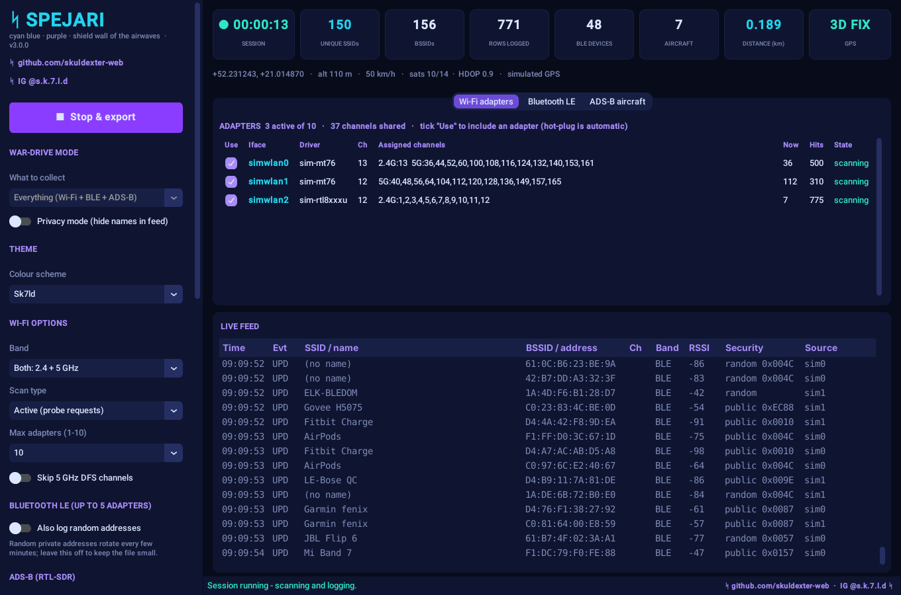
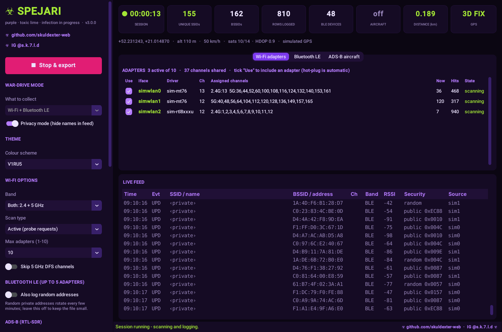
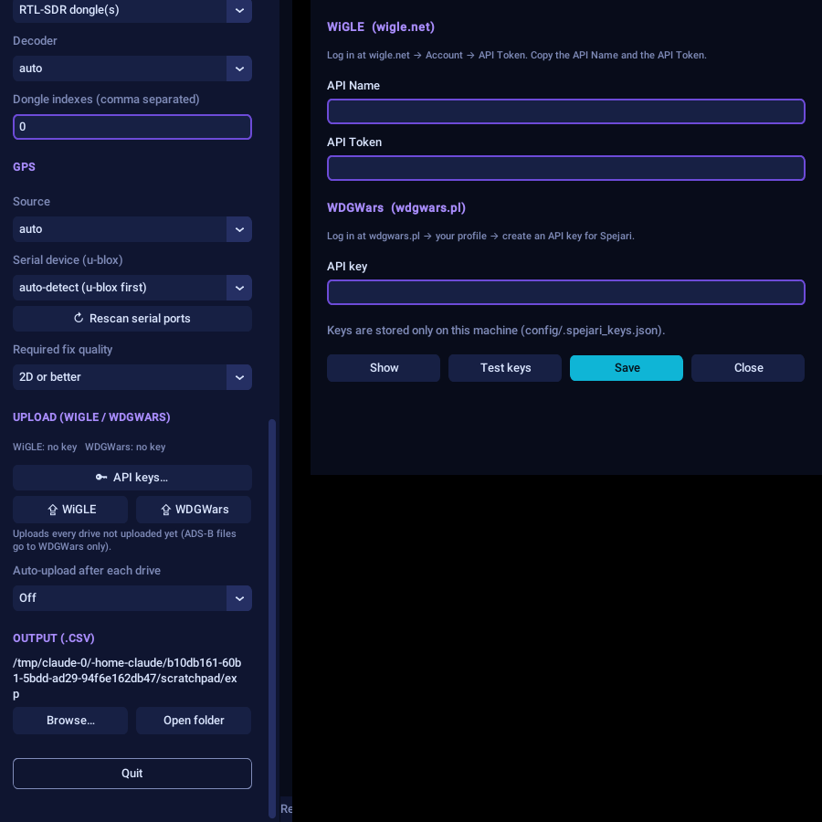
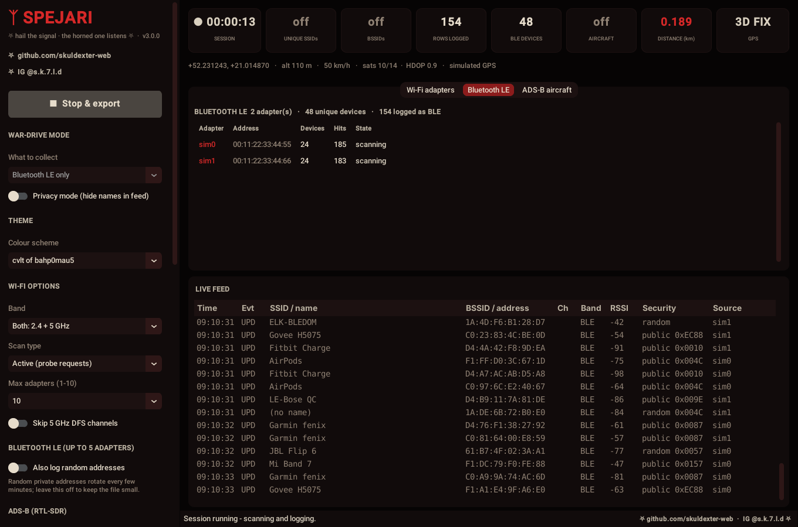
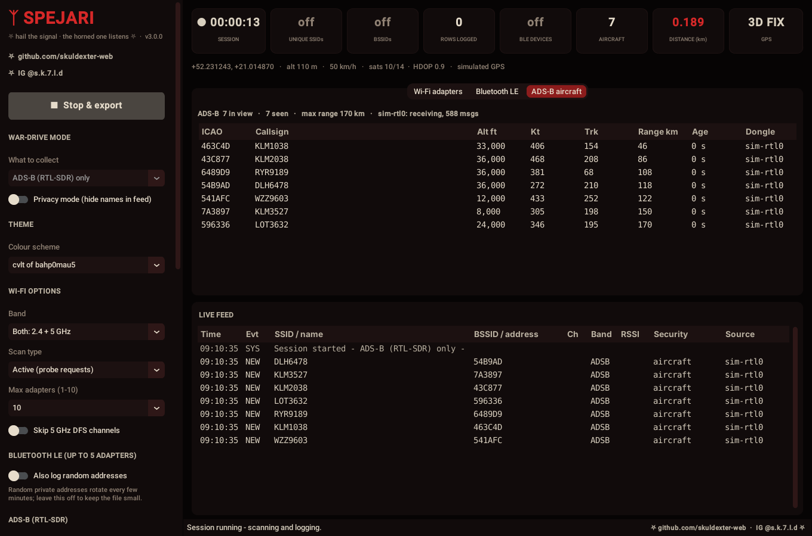

# Spejari

```
⛧ ╔═╗╔═╗╔═╗ ╦╔═╗╦═╗╦ ⛧
ᛉ ╚═╗╠═╝║╣  ║╠═╣╠╦╝║ ᛉ
⛧ ╚═╝╩  ╚═╝╚╝╩ ╩╩╚═╩ ⛧
```

**Spejari** (Old Norse *spejari*, "scout") is a war-driving scout for **Debian, Ubuntu, Kali and Raspberry Pi OS**.
It listens to three kinds of radio, tags everything with your **GPS** position, and uploads the result to
**WiGLE** and **WDGWars** with your own API keys.

| | What it records | Hardware | Output |
|---|---|---|---|
| **Wi-Fi** | 2.4 / 5 GHz networks (SSID, BSSID, RSSI, channel, frequency, security) | up to **10 Wi-Fi adapters**, channels split between them | WiGLE 1.6 `.csv` |
| **Bluetooth LE** | BLE devices (name, address, RSSI, manufacturer) | up to **5 Bluetooth adapters** at once | rows of type `BLE` in the same `.csv` |
| **ADS-B** | Aircraft on 1090 MHz (ICAO, callsign, position, altitude, speed, range) | one or more **RTL-SDR** dongles | `Spejari_ADSB_*.csv` + `.geojson` |

- **Drive modes:** Wi-Fi only, BLE only, ADS-B only, Wi-Fi + BLE, or everything.
- **Privacy mode:** the live feed hides every SSID and device name, for screenshots and streams. The CSV keeps them.
- **Uploads:** to WiGLE and WDGWars from the terminal, from the GUI, or automatically after every drive.
- **Two interfaces:** a terminal dashboard (works over SSH) and a desktop GUI with three themes:
  **Sk7ld**, **V1RU5** and **cvlt of bahp0mau5**.

Made by **SKALDSEC**: [github.com/skuldexter-web](https://github.com/skuldexter-web) · Instagram
[@s.k.7.l.d](https://www.instagram.com/s.k.7.l.d/)

> Use Spejari only where passive listening is legal and only on equipment you are allowed to use. See
> [Legal and ethics](#legal-and-ethics).



---

## Table of contents

- [Quick start](#quick-start)
- [Installation](#installation)
- [Drive modes](#drive-modes)
- [Usage](#usage)
- [Privacy mode](#privacy-mode)
- [Uploading to WiGLE and WDGWars](#uploading-to-wigle-and-wdgwars)
- [Themes](#themes)
- [How Wi-Fi scanning works](#how-wi-fi-scanning-works)
- [GPS setup](#gps-setup)
- [Bluetooth LE war-driving](#bluetooth-le-war-driving)
- [ADS-B war-driving with RTL-SDR](#ads-b-war-driving-with-rtl-sdr)
- [Output files](#output-files)
- [Configuration](#configuration)
- [Hardware recommendations](#hardware-recommendations)
- [Troubleshooting](#troubleshooting)
- [Project layout](#project-layout)
- [Development and tests](#development-and-tests)
- [What has been tested](#what-has-been-tested)
- [Upgrading from Spejari 2](#upgrading-from-spejari-2)
- [Legal and ethics](#legal-and-ethics)

---

## Quick start

```bash
git clone https://github.com/skuldexter-web/spejari.git
cd spejari
python3 install.py            # = ./setup.sh: apt packages, BlueZ service, .venv, Python packages
./run.sh --simulate           # try everything without hardware or root
./run.sh                      # the real thing (asks for sudo, then CLI or GUI)
```

Want ADS-B too? `./setup.sh --adsb` installs the RTL-SDR tools and a decoder.

---

## Installation

```bash
./setup.sh                    # everything except ADS-B
./setup.sh --adsb             # + RTL-SDR tools and an ADS-B decoder (readsb / dump1090)
./setup.sh --no-gui           # headless (Raspberry Pi OS Lite): terminal dashboard only
./setup.sh --no-bluetooth     # skip bluez / bleak
./setup.sh --no-apt           # only create the .venv (you install system packages yourself)
./setup.sh --configure-gpsd   # also point gpsd at your u-blox dongle
```

`setup.sh` installs `iw`, `rfkill`, `gpsd`, `python3-venv`, `python3-tk` and `bluez`. It also **enables the `bluetooth`
service**, which Kali ships switched off. It creates `.venv/` with `rich`, `customtkinter`, `pyserial` and `bleak`.
`python3 install.py` does the same thing.

Requirements: Python 3.9 or newer and Linux with `iw`. Wi-Fi scanning needs root, and `run.sh` asks for sudo for you.
Bluetooth and ADS-B work without root, but as root Spejari can start BlueZ and power on adapters itself.

---

## Drive modes

Pick what you war-drive. You can change the mode in the GUI between drives.

| Mode | `--mode` | What runs |
|---|---|---|
| Wi-Fi only (default) | `wifi` | Wi-Fi adapters |
| Bluetooth LE only | `ble` | Bluetooth adapters, no Wi-Fi (no `iw`, no root needed) |
| ADS-B only | `adsb` | RTL-SDR dongles, nothing else |
| Wi-Fi + Bluetooth LE | `wifi+ble` | both, in one CSV |
| Everything | `all` | Wi-Fi + BLE + ADS-B |

Any `+` combination works, for example `--mode ble+adsb`. The old `--bluetooth` and `--adsb` flags add to the mode,
so `--mode wifi --adsb` gives Wi-Fi + ADS-B. In the GUI use **War-drive mode > What to collect**. The GUI remembers
your choice. In `config/spejari.toml` set `[drive] mode = "..."`.

---

## Usage

```bash
./run.sh                          # asks: CLI or GUI
./run.sh --gui                    # desktop window
./run.sh --cli --auto-start       # terminal dashboard, start scanning at once (great in tmux)
./run.sh --mode all --privacy     # everything, names hidden in the feed
./run.sh --mode ble               # Bluetooth LE only
./run.sh --mode adsb --adsb-device 0 --adsb-device 1   # ADS-B only, two dongles
```

### Terminal keys

| Key | Action |
|---|---|
| `S` | start / stop the drive (stop writes the files) |
| `P` | privacy mode on / off |
| `U` | upload drives that are not uploaded yet (while idle) |
| `Q` | quit (a running drive is stopped and exported first) |

### GUI

The sidebar has **Start / Stop & export**, **War-drive mode**, **Privacy mode**, **Theme**, Wi-Fi options (band, scan
type, max adapters, DFS), Bluetooth options, ADS-B source / decoder / dongles, GPS source and device, **Upload** (API
keys, upload buttons, auto-upload) and the export folder. The main area shows status cards and tabs for **Wi-Fi
adapters** (tick *Use* per adapter), **Bluetooth LE** and **ADS-B aircraft**, plus the live feed.

### Command-line options

```
--cli / --gui              interface
-m, --mode MODE            wifi | ble | adsb | wifi+ble | all  (any + combination)
--privacy / --no-privacy   hide names in the live feed
--theme sk7ld|v1ru5|cvlt   colour theme
-o, --output-dir DIR       where files are written (default ./exports)
--auto-start               start scanning immediately
--simulate [N]             no hardware: N simulated Wi-Fi adapters, GPS drive, BLE devices, aircraft

Wi-Fi:   -i/--interface IFACE  -x/--exclude IFACE  -n/--max-adapters N  -b/--band both|2.4|5  --skip-dfs  --passive
GPS:     --gps auto|gpsd|serial|none  --gps-device /dev/ttyACM0  --gpsd HOST:PORT
BLE:     --bluetooth  --ble-adapter hci1  --ble-exclude hci0  --ble-max N  --ble-log-random
ADS-B:   --adsb  --adsb-device N  --adsb-decoder NAME|PATH  --adsb-external HOST:PORT
Upload:  --keys  --test-keys  --upload wigle|wdgwars|both  --file CSV  --force  --auto-upload off|wigle|wdgwars|both
Info:    --list-adapters  --list-gps  --list-bluetooth  --list-sdr  --recover  --version
```

---

## Privacy mode

Privacy mode replaces every SSID and Bluetooth device name in the live feed with `‹private›`, in both the terminal
dashboard and the GUI. Use it when you stream, record or screenshot a drive. The header shows a **PRIVACY** badge
while it is on.

- Switch it on with `--privacy`, the **Privacy mode** switch in the GUI, the `P` key, or `[ui] privacy = true`.
- Only the screen changes. The CSV still holds the real names, because WiGLE and WDGWars need them.
- MAC addresses and your GPS position are still shown. Crop those out if they matter for your stream.



---

## Uploading to WiGLE and WDGWars

### 1. Get your API keys

- **WiGLE:** log in at [wigle.net](https://wigle.net), open **Account**, then show your **API Token**. You need the
  **API Name** (`AID…`) and the **API Token**.
- **WDGWars:** log in at [wdgwars.pl](https://wdgwars.pl), open your profile, and create an API key for Spejari.

### 2. Store them

```bash
./run.sh --keys          # asks for each key; secrets are not echoed
./run.sh --test-keys     # checks both keys with the sites
```

In the GUI, use **Upload > API keys…**. It has *Test keys* and *Save*.

Keys are saved only on your machine, in `config/.spejari_keys.json`. That file has permissions 600 and is
git-ignored. You can use environment variables instead: `WIGLE_API_NAME`, `WIGLE_API_TOKEN` (or the encoded
`WIGLE_API_ENCODED`) and `WDGWARS_API_KEY`. `run.sh` passes them through sudo.

### 3. Upload

```bash
./run.sh --upload both                    # every drive not uploaded yet, to both sites
./run.sh --upload wigle                   # WiGLE only
./run.sh --upload wdgwars --file exports/Spejari_2026-11-17_20-00-00.csv
./run.sh --cli --auto-upload both         # upload each drive as soon as you stop it
```

In the GUI, the **⇪ WiGLE** and **⇪ WDGWars** buttons upload every drive that has not been sent yet. **Auto-upload
after each drive** does it for you.

- Spejari keeps track of what went where in `exports/.spejari_uploads.json`, so nothing is sent twice. Use `--force`
  to send a file again.
- **WiGLE** gets the Wi-Fi/BLE CSV. The upload goes to `api.wigle.net/api/v2/file/upload` with Basic auth.
  `[upload] wigle_donate` sets WiGLE's "donate" flag, which is off by default.
- **WDGWars** gets the Wi-Fi/BLE CSV and also your ADS-B aircraft, because WDGWars scores aircraft too. Each aircraft
  is sent once, at the first position you heard it. Set `[upload] wdgwars_adsb = false` to skip aircraft.
- Big drives are split into parts of 10,000 rows (`chunk_rows`), and each part keeps both WiGLE header lines.
  Spejari waits when the server says it is busy (HTTP 429), and a duplicate file (HTTP 409) counts as done.
- WDGWars has no official API documentation. Spejari uses the same endpoints as the community WDGWars clients:
  `/endpoint/upload-csv` with the `X-API-Key` header for CSVs, and the HMAC-signed `/endpoint/upload/` for aircraft.
  If the site changes them, an upload fails with a clear message and the file stays marked as *not uploaded*.



---

## Themes

Every theme shows the maker's GitHub and Instagram in the GUI (sidebar and status bar) and in the terminal (banner and
dashboard header).

| Key | Name | Look |
|-----|------|------|
| `sk7ld` | **Sk7ld** | cyan blue and purple on deep navy (default) |
| `v1ru5` | **V1RU5** | purple and toxic lime green |
| `cvlt` | **cvlt of bahp0mau5** | Baphomet style: black, blood red, bone and tarnished silver, horned runes |

The GUI switches themes live and remembers your choice. `--theme` overrides it for one run.

| cvlt of bahp0mau5: Bluetooth LE only | cvlt of bahp0mau5: ADS-B only |
|---|---|
|  |  |

(All screenshots were taken in `--simulate` mode.)

---

## How Wi-Fi scanning works

Spejari scans each adapter with `iw dev <if> scan flush freq …`. It reads the real channel list of every adapter
(`iw phy`) and then **splits the channels across the adapters**: each channel goes to the least-loaded adapter that
supports it, starting with the rarest channels. So one adapter scans everything, two adapters split the list, and a
2.4 GHz-only adapter is never starved because the 5 GHz channels go to the others. When you plug an adapter in or
out, the channels are re-balanced within about two seconds.

**Logging policy:** a network is written the first time it is seen **with a GPS fix**. It is written again after
you move 25 m (`min_distance_m`), or when its signal is 8 dB stronger than before (`rssi_improvement_db`). Networks
seen without a fix appear in the feed but are not written.

Keep the adapter that carries your SSH or internet link out of the scan with `-x wlan0`, or untick it in the GUI.

---

## GPS setup

Any **u-blox** USB receiver works (u-blox 7 / 8 / 9 dongles, NEO-M8N, ZED-F9P), and other NMEA receivers work too.
u-blox devices show up with USB vendor id `1546`. Run `./run.sh --list-gps` to see what Spejari finds. On a PC the
on-board `/dev/ttyS*` ports are hidden; on a Raspberry Pi they stay, because GPS HATs use them.

- **gpsd (recommended):** run `./setup.sh --configure-gpsd`, then `cgps -s` outdoors to check the fix.
- **Direct serial:** without gpsd, `--gps auto` reads NMEA straight from u-blox ports. Pick a port yourself with
  `--gps-device /dev/ttyACM0`.

Rows are timestamped with GPS time, so a Pi without a real-time clock is fine.

---

## Bluetooth LE war-driving

Spejari uses [`bleak`](https://github.com/hbldh/bleak) on top of **BlueZ**, with up to **5 adapters** scanning at the
same time (`hci0` … `hci4`).

```bash
./run.sh --list-bluetooth                # adapters, powered state, BlueZ status
./run.sh --mode ble                      # BLE only
./run.sh --mode wifi+ble --ble-exclude hci0    # keep the built-in adapter free
./run.sh --mode ble --ble-adapter hci1 --ble-adapter hci2
```

- **BlueZ must be running.** Kali ships the `bluetooth` service disabled, and every scan then fails with
  `Unit dbus-org.bluez.service not found`. `setup.sh` enables the service. When Spejari runs as root it also starts the
  service if it is down, unblocks rfkill and **powers on adapters that are down**. To do it by hand:
  `sudo systemctl enable --now bluetooth`.
- **Logging:** each device is logged once per address with your GPS position, using the same rules as Wi-Fi. Rows go
  in the same CSV with `Type = BLE`, `AuthMode = Misc [LE]` and the manufacturer id in `MfgrId`.
- **Random addresses:** most phones and wearables use *rotating* random addresses. Spejari shows them in the feed,
  marked `random`, but does not log them unless you pass `--ble-log-random`.
- Hot-plug is checked every 5 seconds. `min_rssi` drops very weak devices.

---

## ADS-B war-driving with RTL-SDR

Spejari starts a proven decoder (**readsb**, **dump1090-fa**, **dump1090-mutability** or **dump1090**) once for **each
RTL-SDR dongle**. It reads each decoder's SBS feed and keeps a live aircraft table with the **range from your GPS
position**. Decoders run only while a drive is running.

**Install:** `./setup.sh --adsb` installs `rtl-sdr` and blacklists the DVB-T driver that would otherwise grab the
dongle. It then installs a decoder from apt, or builds readsb into `./tools/` when none is packaged. Unplug and
replug the dongle once afterwards. `./run.sh --list-sdr` shows your dongles, the decoder Spejari will use, and which
dongle indexes it will run.

```bash
./run.sh --mode adsb                                   # dongle 0
./run.sh --mode adsb --adsb-device 0 --adsb-device 1   # two dongles, two decoders
./run.sh --mode adsb --adsb-external 127.0.0.1:30003   # use a decoder that is already running
```

- Each dongle gets its own SBS port: `base_port + 10 × n`, so 30103, 30113 and so on. Set gain and PPM in `[adsb]`.
- Each aircraft position is logged at most every 5 s (`log_interval_s`), together with your own position and the
  range. That gives you a coverage map of your route.
- Output: `Spejari_ADSB_*.csv` and a `.geojson` file with one track per aircraft plus your own drive. Open it in
  geojson.io, QGIS or Google Earth.

---

## Output files

When you stop a drive, Spejari writes to `exports/` (change it with `-o DIR`). Extensions are always lowercase:

- `Spejari_YYYY-MM-DD_HH-MM-SS.csv`: Wi-Fi and BLE rows in **WigleWifi-1.6** format (written when the mode includes Wi-Fi or BLE)
- `Spejari_ADSB_YYYY-MM-DD_HH-MM-SS.csv` and `.geojson`: written when the mode includes ADS-B and aircraft were heard

```
WigleWifi-1.6,appRelease=Spejari 3.0.0,model=Raspberry Pi 4 Model B Rev 1.4,release=6.6.31,device=raspberrypi,display=,board=aarch64,brand=Spejari,star=Sol,body=3,subBody=0
MAC,SSID,AuthMode,FirstSeen,Channel,Frequency,RSSI,CurrentLatitude,CurrentLongitude,AltitudeMeters,AccuracyMeters,RCOIs,MfgrId,Type
AA:BB:CC:00:00:17,CoffeeShop,[WPA2-PSK-CCMP][ESS],2026-11-09 23:02:53,6,2437,-63,52.22967700,21.01227800,110.4,4.5,,,WIFI
D4:16:8D:4D:05:EF,Mi Band 7,Misc [LE],2026-11-09 23:03:10,0,0,-51,52.22971000,21.01230000,110.2,4.5,,343,BLE
```

`FirstSeen` is UTC. Hidden networks have an empty SSID. Files created under sudo are handed back to your user.

**Crash recovery:** every logged row is also written straight away to `exports/.spejari_*.journal`. After a crash or
power cut, run `./run.sh --recover` to turn the journals into CSV files.

---

## Configuration

`config/spejari.toml` lists every option with its default and a comment. Its sections are `[drive]`, `[scan]`,
`[log]`, `[gps]`, `[ui]`, `[bluetooth]`, `[adsb]` and `[upload]`.

Precedence: command-line flags win over choices remembered by the GUI (`config/.spejari_user.json`), and those win
over the TOML file.

---

## Hardware recommendations

- **Wi-Fi:** use adapters with in-kernel drivers: MediaTek mt76 (MT7612U, MT7610U, MT7921) or Intel AX200/AX210.
  Realtek USB adapters often need DKMS drivers. Use powered USB hubs when you run more than two adapters.
- **GPS:** a u-blox 7 / 8 / 9 USB receiver, placed on the dashboard or roof.
- **Bluetooth:** any BlueZ-supported USB Bluetooth 4.0+ adapter. Several cheap adapters can scan in parallel (up to 5).
- **ADS-B:** an RTL-SDR (RTL2832U + R820T2, ideally with a TCXO) with a 1090 MHz antenna on the roof.
- **Computer:** a Raspberry Pi 4 / 5 or a laptop. In a car, use a good 12 V → 5 V 3 A supply. Run headless in `tmux`
  with `--cli --auto-start`.
- **Raspberry Pi:** set your regulatory domain (`sudo iw reg set NL`) so all legal channels are enabled.

---

## Troubleshooting

| Symptom | Fix |
|---------|-----|
| `Bluetooth hci0: … Unit dbus-org.bluez.service not found` | BlueZ is not running: `sudo apt install bluez && sudo systemctl enable --now bluetooth` (Spejari tries this itself as root). Check with `--list-bluetooth` |
| `--list-bluetooth` shows *Powered: no* | Run Spejari as root (it powers them on), or `sudo btmgmt --index 0 power on` / `bluetoothctl power on` |
| Bluetooth: devices listed but nothing logged | Their addresses are random: add `--ble-log-random` if you really want them |
| `Wi-Fi scanning needs root privileges` | Start with `./run.sh` (it uses sudo), or use `--mode ble` / `--mode adsb` |
| `No scan-capable wireless adapter detected` | `./run.sh --list-adapters`; check `iw dev` and `rfkill list` (`sudo rfkill unblock wifi`) |
| Adapter state is `busy` all the time | NetworkManager is scanning on it: `sudo nmcli device set wlan1 managed no` |
| A scan drops my SSH session | You are scanning the interface that carries it: `-x wlan0` |
| GUI: `Cannot open the GUI` | Start it from a desktop session with `./run.sh --gui`, or run `xhost +SI:localuser:root` |
| GUI: `No module named tkinter` | `sudo apt install python3-tk`, then re-run `./setup.sh` |
| `No GPS found` | `--list-gps`, `systemctl status gpsd`; choose the port with `--gps-device /dev/ttyACM0` |
| Networks in the feed but nothing exported | There was no GPS fix: rows without coordinates are never written |
| ADS-B: `No ADS-B decoder found` | `./setup.sh --adsb`, or use `--adsb-external HOST:PORT`; check with `--list-sdr` |
| ADS-B: decoder exits right away | The kernel DVB driver has the dongle (replug it after `setup.sh --adsb`), or the device index is wrong |
| Upload: `rejected the key` | Run `./run.sh --keys` again, then `--test-keys`. WiGLE needs the API Name **and** the API Token |
| Upload: `HTTP 524` from WDGWars | The server timed out; the rows may still be imported. Lower `[upload] chunk_rows` and try again later |
| Upload: `network error` | No internet, or a captive portal. The files stay pending; upload again later |

---

## Project layout

```
spejari/
├── main.py  install.py  run.sh  setup.sh
├── requirements.txt  requirements-dev.txt  pytest.ini
├── config/spejari.toml
├── spejari/
│   ├── cli.py  app.py  config.py  models.py  session.py  settings.py  themes.py
│   ├── ui.py  gui.py                       terminal dashboard and desktop GUI
│   ├── gps.py  geo.py  exporter.py  channels.py  parser.py  iwtools.py
│   ├── upload.py                           WiGLE / WDGWars uploader (standard library only)
│   ├── wifi/        adapters.py scanner.py sim.py      iw + channel clustering (+ simulator)
│   ├── bluetooth/   engine.py sim.py                   bleak scanners, one per adapter, BlueZ helper
│   └── adsb/        engine.py sbs.py tracker.py export.py
├── tests/
└── .github/workflows/tests.yml
```

---

## Development and tests

```bash
python3 -m venv .venv && .venv/bin/pip install -r requirements-dev.txt
.venv/bin/python -m pytest
```

The tests cover:

- channel balancing, `iw` parsing and the simulated adapters running through the real engine
- GPS / NMEA parsing, the logging rules, and the WiGLE 1.6 exporter with its journals
- Bluetooth address handling, BlueZ error messages and the 5-adapter limit
- the ADS-B parser, tracker and decoder management (using fake decoder processes)
- every drive mode, privacy mode, all three themes with the credits, and the CLI
- the uploader, against a local fake of the WiGLE and WDGWars APIs: auth, chunking, 429/409/413 handling, aircraft
  signing, and the upload log
- complete simulated drives

---

## What has been tested

- **Automatically, on Linux:** the full test suite; the terminal dashboard in a pseudo-terminal (all modes and
  privacy mode, which exports correctly); the GUI in all three themes (screenshots above); and the BLE-only and
  ADS-B-only modes. All of this used simulated adapters, GPS, Bluetooth and aircraft.
- **Against real decoder programs:** the readsb 3.16 and dump1090-mutability 1.15 command lines.
- **Against the live upload sites:** not tested, because no API keys were available. The upload requests follow WiGLE's
  documented API and the community WDGWars clients. Run `./run.sh --test-keys` first; if a site has changed, the error
  says so and the file stays pending.
- **On real hardware:** not tested. That means real Bluetooth adapters (the BlueZ auto-start and power-on are new in
  3.0), real RTL-SDR reception, and dump1090-fa / classic dump1090.

If something does not work, please open an issue with the output of `--list-adapters`, `--list-bluetooth` and
`--list-sdr`.

---

## Upgrading from Spejari 2

- **Windows and the WiFi Pineapple Nano are no longer supported.** Spejari 3 is Linux-only (Debian, Kali,
  Raspberry Pi OS). If your config has `[[pineapple]]` blocks, delete them; Spejari warns you about them.
- `[bluetooth] enabled` and `[adsb] enabled` still work, but `[drive] mode` replaces them.
- The CSV is now WigleWifi-1.6, which adds the Frequency, RCOIs and MfgrId columns. WiGLE and WDGWars both accept it.

---

## Legal and ethics

Passive listening to broadcasts (beacons, advertisements, ADS-B) is legal in many places and not in others; rules differ
by country. Wi-Fi scans send probe requests by default (`--passive` turns that off). Do not connect to, probe or
interfere with networks and devices you do not own. Do not publish anything that identifies private people;
privacy mode helps when you stream. You are responsible for following local law and the terms of WiGLE, WDGWars and
any other service you upload to.

## License

MIT - see [LICENSE](LICENSE).
